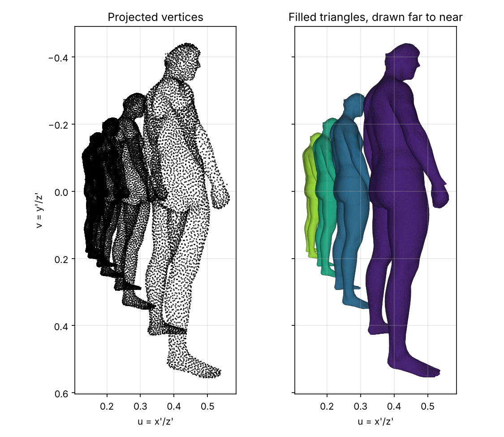
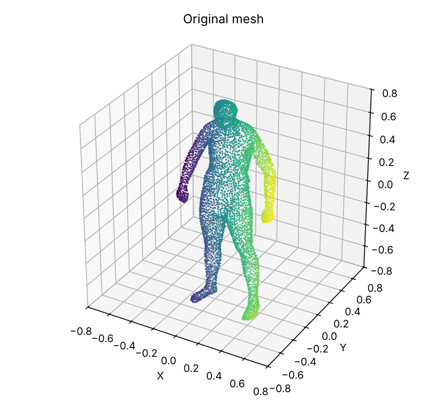
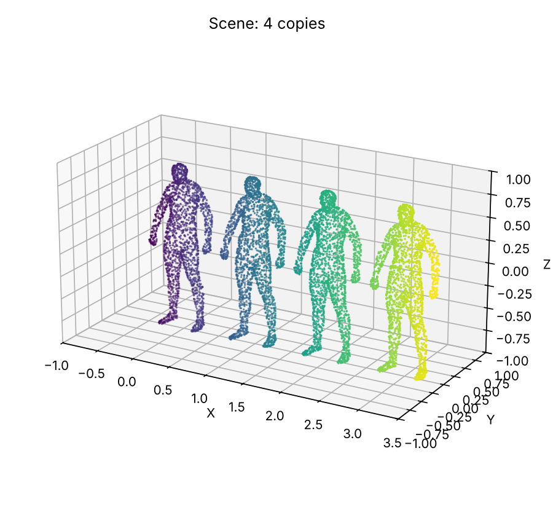

# Pinhole camera model: projecting a 3D mesh to an image

A from-scratch implementation of the pinhole camera's **extrinsic transform and perspective
projection** in NumPy. A triangle mesh of a human figure (`man_small.stl`) is copied four times
along a line, and the scene is projected onto the image plane of a virtual camera placed off to the side.



*Left: the projected mesh vertices. Right: the same triangles filled and drawn far-to-near
(painter's algorithm), which shows which figure hides which.*

## Steps

1. **Mesh.** `man_small.stl` has 12,894 triangles: 38,682 corner entries, of which 6,449 are unique
   vertices. The figure is Z-up and spans about 1.83 units in Z.
2. **Scene.** Four copies, shifted by 0, 1, 2 and 3 units along world X.
3. **Extrinsics.** The camera centre is C = (−2, 0.8, 0) and its rotation is R = R<sub>y</sub>(−90°) · R<sub>x</sub>(90°):

   ```
   R = [ 0 -1  0 ]     t = -R C = [ 0.8 ]     P_extr = [ R  t ]
       [ 0  0 -1 ]                [ 0   ]              [ 0  1 ]
       [ 1  0  0 ]                [ 2   ]
   ```

   Each row of R is a camera axis written in world coordinates. The camera's viewing direction z′
   is world +X, its x′ is world −Y and its y′ is world −Z. So the camera looks along the row of
   figures, and image "down" is world "down".
4. **Projection.** Points in homogeneous form, Q′ = P<sub>extr</sub> Q, then u = x′/z′, v = y′/z′.
   Points with z′ ≤ 0.1 (behind or too close to the camera) are discarded before the division.
   All 154,728 points of this scene lie in front of the camera.

| Original mesh | Scene |
|---|---|
|  |  |

## Perspective check

Apparent height in the image (range of v) of each figure, from `figures/summary.json`:

| Copy | Mean depth z′ | Image height | Height × depth |
|---|---|---|---|
| 0 | 2.0 | 0.995 | 1.99 |
| 1 | 3.0 | 0.643 | 1.93 |
| 2 | 4.0 | 0.475 | 1.90 |
| 3 | 5.0 | 0.377 | 1.89 |

The image height falls roughly as 1/depth, as perspective projection predicts. The product is not
exactly constant because each figure has its own depth extent: the parts nearest to the camera
are enlarged more, and this effect is strongest for the closest figure.

## Run it

```bash
pip install -r requirements.txt
python camera_projection.py                       # writes figures/ and figures/summary.json
python camera_projection.py --camera -3 0.8 0.2   # move the camera
python -m pytest -q tests
```

The tests check that R is a proper rotation (orthonormal, determinant +1) equal to the hand-derived
matrix, that the camera centre maps to the origin, that a point on the optical axis projects to
(0, 0), that the near-plane clipping works, and that farther figures appear smaller.

## Limitations

- **No intrinsic matrix.** The focal length is 1 and there is no principal point or pixel size, so
  (u, v) are normalised image coordinates, not pixels. Multiplying by an intrinsic matrix K would
  give pixel coordinates.
- **Approximate occlusion.** The filled rendering sorts whole triangles by mean depth. It looks
  right for this scene but can fail where triangles overlap in depth; a z-buffer would be exact.
- **Course origin.** Written as a course assignment on camera models.
